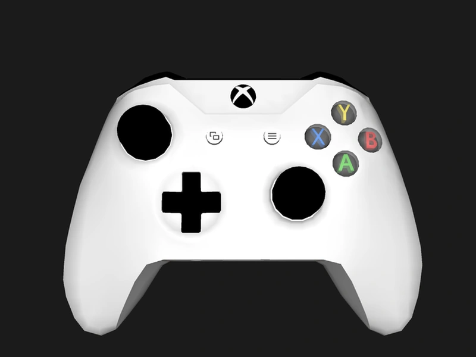
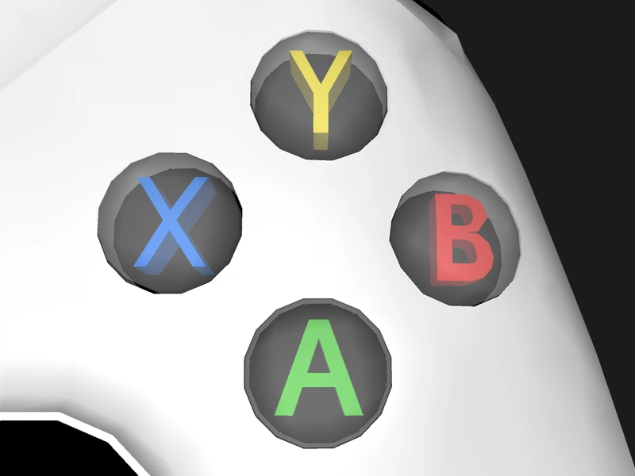
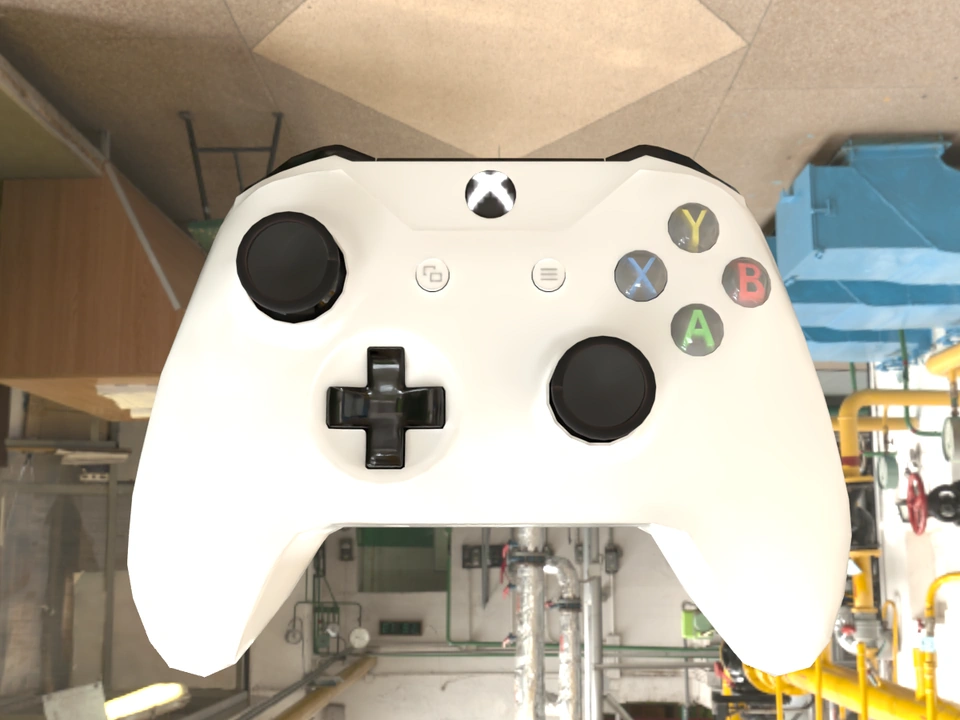
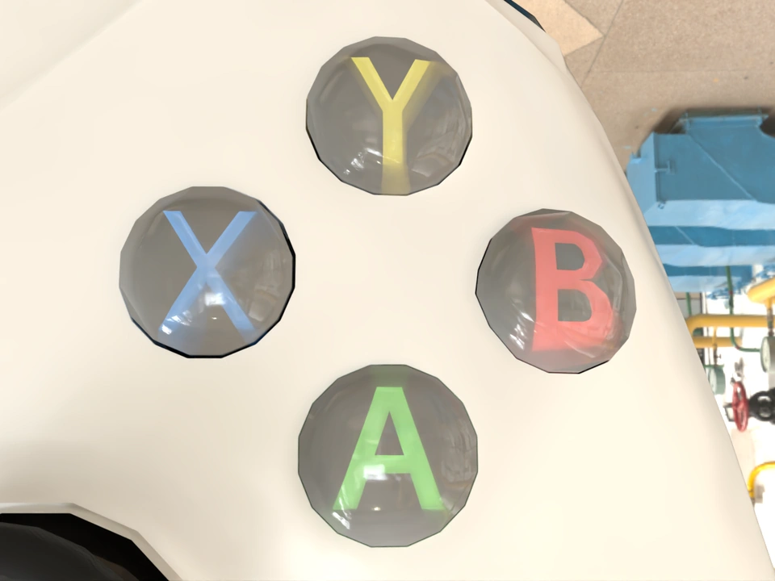

# Xbox One S Gamepad Physics

Xbox One S physical gamepad assets for RoboTwin/SAPIEN and MuJoCo, with an
Isaac Lab preview, 20 active joints,
21 game input channels plus a separate Pair event, and a 32-dimensional canonical
state. The `full_controls` profile uses SDF collision meshes by default; CoACD
is available as an explicit option.

## Demo

Keyboard and mouse teleoperation of a floating gripper interacting with the
Xbox One S gamepad (v0.3.0, SDF + SAPIEN 3.0.3). Full Release video:
[`xbox_teleop_demo_v0.3.0.mp4`](https://github.com/5o1/xbox_gamepad_physics/releases/download/v0.3.0/xbox_teleop_demo_v0.3.0.mp4).

https://github.com/user-attachments/assets/437b2daa-8db3-4d99-9adf-82efef8c7dae

## Features

- Textured Xbox One S model with 2K PBR textures and articulated controls.
- Load into an existing RoboTwin task or SAPIEN scene with a caller-selected pose.
- Read signals and set joint positions or drive targets by name.
- Fix or release the root at runtime with CPU PhysX.
- Packaged examples, browser viewer, signal overlay, and local teleoperation.
- Offline resource import and local generation from approved inputs.

## Requirements

Targets are Linux x86_64. RoboTwin uses NVIDIA graphics, Python 3.10,
the [RoboTwin fork](https://github.com/5o1/RoboTwin), and SAPIEN 3.0.3.
MuJoCo supports Python 3.10/3.11 with the fork wheel below; rendering requires
a working graphics driver. The Isaac preview requires the external Python 3.11,
Lab 2.3.2 / Sim 5.1 stack and compatible torch. Optional tools depend on the entry point:

| Feature | Additional requirements |
| --- | --- |
| Teleoperation | FFmpeg with working `h264_nvenc`, NVIDIA drivers/Vulkan, and a browser supporting H.264 WebCodecs and Pointer Lock; your own RoboTwin aloha-agilex gripper assets |
| Cycles viewer | Blender 4.5, supplied with `--blender` |
| Checkout npm entry points and JavaScript tests | Node 22 |

Node and Blender are not required for packaged local teleoperation. Python
extras install Python dependencies; external tools and RoboTwin assets must be
provided separately.

## Backend and rendering support

| Backend | Version | Raster | Ray tracing | Status⁶ |
| --- | --- | --- | --- | --- |
| SAPIEN | 3.0.3 | Yes¹ | Optional² | Ready |
| Blender | 4.5.9 | — | Cycles³ | Reference |
| MuJoCo | 3.16.0 | Yes⁴ | — | Ready |
| Isaac Sim | 5.1 | — | Yes⁵ | Preview |

¹ SAPIEN raster uses the frozen `visual_meshbase` face groups for ABXY lettering. Use `load_into_scene`; direct mesh/URDF imports bypass materials and SDF setup. SDF is the default; provide a static box, not `add_ground`, as support.

² SAPIEN ray tracing is optional. Firefly noise and faint ABXY lettering are known issues; OIDN helps noise but does not resolve the lettering limitation. Opting into review rendering changes global shader settings.

³ Cycles is the approved Boiler Room appearance reference, not an interactive runtime requirement.

⁴ MuJoCo uses the owner-maintained `3.16.0+concon.sdf3689.2` fork wheels from its Release, selected by `[mujoco]`. They fix 3.16.0 mesh SDF sign errors using upstream PR #3689 before upstream merge. SDF is the default; CoACD is an explicit comparison. The classic-renderer K5 appearance was approved on 2026-10-21. The 23° circular limit has a first peak of about 23.35°, temporarily accepted by the owner; a strict hard bound is not established. Recorded acceptance cost is 10.45 ms per 4 ms simulation step: not real time.

⁵ Isaac is a preview with external Python 3.11, Isaac Lab 2.3.2, Isaac Sim 5.1 and compatible torch prerequisites; its extra does not install them. Start AppLauncher before building USD or importing pxr. SDF 0.5 mm is the default. Real-time RTX (`RaytracedLighting`) makes ABXY blurrier; use path tracing for high-quality images. Guide regresses to 0.931 against the baseline; Pair, L3 and R3 also fail. These issues remain open.

⁶ Ready describes supported loading and reviewed appearance; Preview retains the documented limitations. Neither rendering support nor the press scores below establish hardware calibration or complete contact qualification. SAPIEN and Cycles images were rendered on 2026-10-16; MuJoCo and Isaac images were rendered by the released backends and reviewed on 2026-10-21.

### Contact acceptance (26 frozen presses)

| Backend | Passed⁷ |
| --- | --- |
| SAPIEN | 23/26 |
| MuJoCo | 25/26 |
| Isaac | 22/26 |

⁷ SDF results with the frozen rules: SAPIEN fails Pair/L3/R3; MuJoCo fails Pair; Isaac fails Guide/Pair/L3/R3. The owner parked Isaac Guide and L3/R3 investigation on 2026-10-21. These are simulation observations, not hardware calibration. See [the current plan and known issues](docs/plan.md), [MuJoCo usage](docs/mujoco_backend.md) and [Isaac preview usage](docs/isaac_backend.md).

<table>
<tr>
<td><a href="docs/media/backends/a_sapien_raster_full.webp"></a><br>SAPIEN · raster<br>Full · 2026-10-16</td>
<td><a href="docs/media/backends/a_sapien_raster_abxy.webp"></a><br>SAPIEN · raster<br>ABXY · 2026-10-16</td>
</tr>
<tr>
<td><a href="docs/media/backends/b_sapien_rt_full.webp"></a><br>SAPIEN · ray tracing (OIDN)<br>Full · 2026-10-16</td>
<td><a href="docs/media/backends/b_sapien_rt_abxy.webp"></a><br>SAPIEN · ray tracing (OIDN)<br>ABXY · 2026-10-16</td>
</tr>
<tr>
<td><a href="docs/media/backends/c_cycles_full.webp"></a><br>Blender · Cycles<br>Full · 2026-10-16</td>
<td><a href="docs/media/backends/c_cycles_abxy.webp"></a><br>Blender · Cycles<br>ABXY · 2026-10-16</td>
</tr>
<tr>
<td><a href="docs/media/backends/e_mujoco_m2_full.webp"></a><br>MuJoCo · classic<br>Full · review 2026-10-21</td>
<td><a href="docs/media/backends/e_mujoco_m2_abxy.webp"></a><br>MuJoCo · classic<br>ABXY · review 2026-10-21</td>
</tr>
<tr>
<td><a href="docs/media/backends/f_isaac_pathtracing_full.webp"></a><br>Isaac Sim · path tracing<br>Full · review 2026-10-21</td>
<td><a href="docs/media/backends/f_isaac_pathtracing_abxy.webp"></a><br>Isaac Sim · path tracing<br>ABXY · review 2026-10-21</td>
</tr>
</table>

## Install

Download the wheel and resource zip from the
[latest Release](https://github.com/5o1/xbox_gamepad_physics/releases/latest).
The package is distributed through Release attachments rather than PyPI.

```sh
python3.10 -m pip install "./xbox_gamepad_physics-0.4.1-py3-none-any.whl[build,robotwin]"
python3.10 -m xbox_gamepad_physics build-resources \
  --archive ./xbox_gamepad_physics-resources-0.4.1.zip \
  --resources ./gamepad_resources --offline
export XBOX_GAMEPAD_PHYSICS_RESOURCES="$PWD/gamepad_resources"
python3.10 -m xbox_gamepad_physics verify --backend robotwin --profile full_controls
```

For MuJoCo on Linux x86_64 with Python 3.10 or 3.11, install the `mujoco`
extra (add `build` when generating resources):

```sh
python -m pip install "./xbox_gamepad_physics-0.4.1-py3-none-any.whl[mujoco]"
```

The extra selects a matching wheel directly from the owner-maintained
[fork Release v3.16.0-concon.sdf3689.2](https://github.com/5o1/mujoco/releases/tag/v3.16.0-concon.sdf3689.2),
with a pinned SHA256. It corrects MuJoCo 3.16.0 mesh SDF sign errors using
[upstream PR #3689](https://github.com/google-deepmind/mujoco/pull/3689) before
that patch is merged upstream. The installed distribution is
`3.16.0+concon.sdf3689.2`. Other Python/platform combinations have no fork wheel
selected by this extra. Isaac Lab, Isaac Sim and torch are external prerequisites;
the `isaac` extra does not install them.

For the Isaac preview, use your existing Python 3.11 / Lab 2.3.2 / Sim 5.1
installation and its compatible torch. Install the wheel in that environment
(or a venv inheriting it); these platform dependencies are external:

```sh
python -m pip install "./xbox_gamepad_physics-0.4.1-py3-none-any.whl[build,isaac]"
```

Start AppLauncher before the dedicated `isaac.build_usd` path. The generic
`build-resources --backend isaac` entry reports the platform prerequisite;
it does not launch Isaac automatically. Follow [Isaac preview usage](docs/isaac_backend.md)
for the common-input preparation and native build/load sequence.

Add the `example` extra for exported examples or `teleop` for teleoperation,
for example `[build,robotwin,example,teleop]`. The repository is private:
automatic downloads fail without authentication. Download the attachments while
signed in, then import the zip with `--archive` as shown above.

The resource zip is build input (source meshes and frozen snapshots), not
ready-to-load resources: run `build-resources` once to generate the URDF and
manifests. The wheel builds runtime resources in your resource directory from the approved
input zip. Basic resource generation requires neither Blender nor a CoACD run.
`verify` checks resource readiness and required files; see
[resource import documentation](docs/importing.md) for details.

## Quick start

Add this method to your RoboTwin task, or merge its contents into your existing
`load_actors()`. Choose the root pose for your own scene; the example uses meters
and quaternion order `[qw, qx, qy, qz]`.

```python
from xbox_gamepad_physics import GamepadState, XBOX_ONE_S_CHANNELS
from xbox_gamepad_physics.robotwin import load_into_scene


def load_actors(self):
    self.gamepad = load_into_scene(
        self.scene,
        pose=[0.0, 0.0, 0.8, 1.0, 0.0, 0.0, 0.0],
        fixed_root=True,
        profile="full_controls",
        collision="sdf",  # Use "coacd" to select convex hulls.
    )
    state = self.gamepad.gamepad_state()
    print(state.channel("left_x"), state.channel("south"))
    target = GamepadState.from_mapping(
        {"left_x": 0.5, "south": 1.0},
        device_id=state.device_id,
        available_channels=XBOX_ONE_S_CHANNELS,
    )
    self.gamepad.set_gamepad_targets(target)
    self.gamepad.set_joint_target("left_stick_x", 0.0)
    self.gamepad.set_root_fixed(False)
```

Drive targets take effect during subsequent physics steps. For direct state
synchronization, `set_gamepad_state(target)` writes joint positions instead.
Call `set_root_fixed(bool)` only between completed physics steps; it supports
CPU PhysX, including GPU rendering, and rejects GPU/batched PhysX. Full
integration details are in [RoboTwin backend documentation](docs/robotwin_backend.md).

## Integration checklist

1. Use Linux x86_64 with NVIDIA graphics, Python 3.10 and SAPIEN 3.0.3
   (required for SDF). Install the wheel with `[build,robotwin]`, import the input
   zip offline, and run `xbox-gamepad-physics doctor`.
2. Load through `xbox_gamepad_physics.robotwin.load_into_scene` into your own
   scene and choose its pose. Direct mesh or URDF loading loses the appearance
   materials, SDF configuration and signal mapping. Generated resource directories
   are internal build products; their README files point back to this API.
3. Interact through the returned handle and adapt signals by channel name
   (see the button names below).
   Use a static box as the supporting table: SDF does not contact `add_ground`
   planes. Call `diagnose_scene(scene)` to inspect integration mistakes without
   changing the scene.
4. Keep your existing scene, lights and cameras. The default raster renderer
   displays ABXY lettering using the frozen split visual mesh. For a new scene,
   use the public `robotwin.create_scene` API. The optional
   `robotwin.apply_review_rendering` reproduces review rendering by changing
   SAPIEN **global** camera shader and ray tracing settings, affecting all cameras;
   call it only when you intend that change.
5. Run `xbox-gamepad-physics guide` for the full instructions or
   `xbox-gamepad-physics example export ./gamepad_example` for a standalone runner.
   Import public APIs from `robotwin`; do not depend on internal `examples`
   modules for downstream integration.

Channel names follow SDL3 and name buttons by position, not by Xbox label:

| Xbox control | Channel | Range |
| --- | --- | --- |
| A / B / X / Y | `south` / `east` / `west` / `north` | 0–1 |
| View / Xbox / Menu | `back` / `guide` / `start` | 0–1 |
| LB / RB | `left_shoulder` / `right_shoulder` | 0–1 |
| LT / RT | `left_trigger` / `right_trigger` | 0–1 |
| Left stick tilt | `left_x`, `left_y` | −1–1 |
| Right stick tilt | `right_x`, `right_y` | −1–1 |
| Stick click | `left_stick` / `right_stick` | 0–1 |
| D-pad | `dpad_up` / `dpad_down` / `dpad_left` / `dpad_right` | 0–1 |

For example, `GamepadState.xbox_one_s({"south": 1.0, "left_x": 0.8})` presses A
and tilts the left stick. Pair is a physical event, not a channel.

The loader reserves collision `groups[2]` bit31 (`0x80000000`) and sets
`groups[3] = 0x5842` to filter contacts between gamepad shapes. It preserves
`groups[0]` and `groups[1]`. Check your application's collision group allocation:
reusing this bit and identifier on other objects can suppress intended contacts.

## Entry points

Examples export a runner and two configurations into a directory you choose:

```sh
xbox-gamepad-physics example export ./gamepad_example
python3.10 ./gamepad_example/run_robotwin.py ./gamepad_example/smoke_full_controls.yaml --resources ./gamepad_resources
python3.10 ./gamepad_example/run_robotwin.py ./gamepad_example/render_review.yaml --resources ./gamepad_resources --output ./review_output
```

Local teleoperation is the default. Supply your RoboTwin checkout and a new
session output directory; open the URL printed when the session is ready:

```sh
xbox-gamepad-physics teleop --robotwin-root /path/to/RoboTwin --gpu 0 --resources ./gamepad_resources --output ./teleop_session
```

`--gpu` selects an index in the caller-visible device list. Remote mode and
replay are described in [the teleoperation documentation](docs/importing.md).

Start the viewer or overlay with the installed commands:

```sh
xbox-gamepad-physics viewer --resources ./gamepad_resources --offline --blender /path/to/blender
xbox-gamepad-physics overlay
xbox-gamepad-physics overlay --trace-dir ./my_traces
```

The viewer is a kinematic inspector using the approved Blender/Cycles scene.
Without Blender, the page opens but Cycles rendering is unavailable. The overlay
prints a URL with a synthetic canonical demo trace. For your own trace, use the
printed address with `trace=/traces/<file>.json&autoplay=1`. See
[viewer documentation](viewer/README.md). From a checkout, the corresponding
entries are `npm run viewer -- --blender /path/to/blender` and
`npm run gamepad-overlay`.

## Signals and state

`GamepadState` uses `sdl3-gamepad-core-v1`: six SDL3 axes followed by 26 buttons,
with `available_mask`, `task_mask`, and `device_id`. Adapt by channel name rather
than array index. Unavailable channels are zero; `action_mask` is the intersection
of both masks. Xbox One S exposes 21 game channels; Pair is read separately with
`physical_events()` and written with `set_physical_events()`.

`GamepadSignalController` handles normalization, saturation, stick radial limits,
D-pad splitting, deadzones, and masks. The browser's 21-value W3C layout is a
boundary adapter. See [full controls](docs/full_controls.md) for the interface and
[project background](docs/project_background.md) for the detailed contracts.

## Known limitations

- Physical parameters remain estimates pending real-device calibration.
- Teleoperation still exhibits passive finger overspeed under external loads,
  inertia, and depenetration; diagnosis remains unresolved.
- Gripper contact with sticks can penetrate by approximately 2 mm.
- Freezing a tilted gamepad can produce stick signals of approximately 0.03.
- SAPIEN SDF does not collide with `add_ground` planes or another SDF object; use a
  static box for the supporting table.
- MuJoCo requires the fork wheel; transient limit overshoot and non-real-time
  acceptance cost remain as documented above.
- Isaac is a preview with the contact, batch and rendering limits in its
  [usage guide](docs/isaac_backend.md).

Loading and signal round trips do not establish contact-physics readiness or RL
results. See [release status and limitations](docs/plan.md) for the recorded scope.

## Documentation

The following documents are in Chinese:

- [Installation and resource import](docs/importing.md)
- [RoboTwin backend integration](docs/robotwin_backend.md)
- [MuJoCo backend integration](docs/mujoco_backend.md)
- [Isaac preview integration](docs/isaac_backend.md)
- [Full controls and signal interface](docs/full_controls.md)
- [Pending visual review and measurements](docs/pending_user_review.md)
- [Release status and plans](docs/plan.md)
- [Collision optimization](docs/collision_optimization.md)
- [Project background, evidence, and maintenance history](docs/project_background.md)

## Development

Install from a checkout with the build extra, then run the local regression:

```sh
python3.10 -m pip install -e ".[build]"
python3.10 scripts/run_regression.py fast
```

Node 22 is needed for the JavaScript portion. Tests requiring optional dependencies
report skips. Existing setuptools 59 environments can use `--no-build-isolation`;
maintainer resource and evidence workflows are documented in
[project background](docs/project_background.md).

## License and attribution

Project code is [MIT licensed](LICENSE). The Xbox One S model is
[BatonyRobson's Xbox One S Controller/Gamepad (Animated)](https://sketchfab.com/3d-models/xbox-one-s-controllergamepad-animated-a62cf7475b7d4ead9fbf1a86e5a2b6a4),
licensed under [CC BY 4.0](https://creativecommons.org/licenses/by/4.0/).
The packed Boiler Room HDR by Oliksiy Yakovlyev / Poly Haven is CC0.
The gamepad-overlay renderer is Unlicense; Three.js is MIT.
See [third-party notices](THIRD_PARTY_NOTICES.md) and
[Three.js license](src/xbox_gamepad_physics/web/static/vendor/three/LICENSE).
