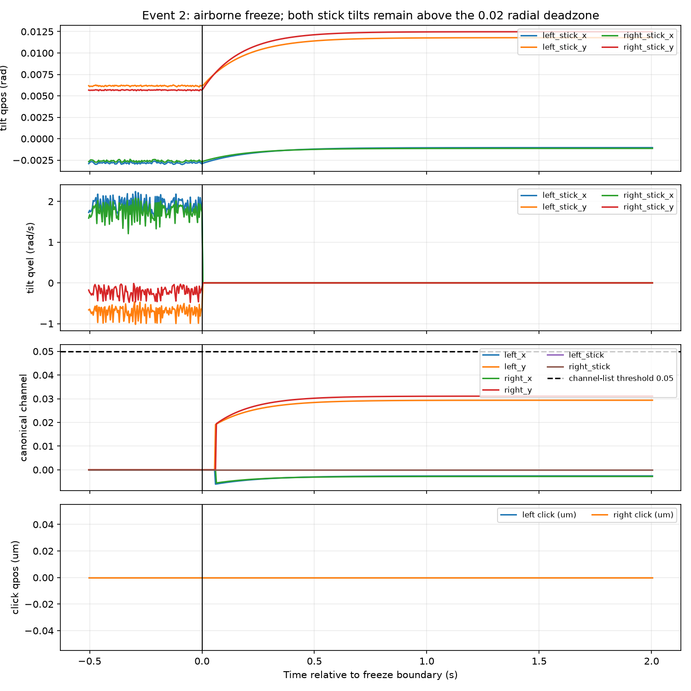
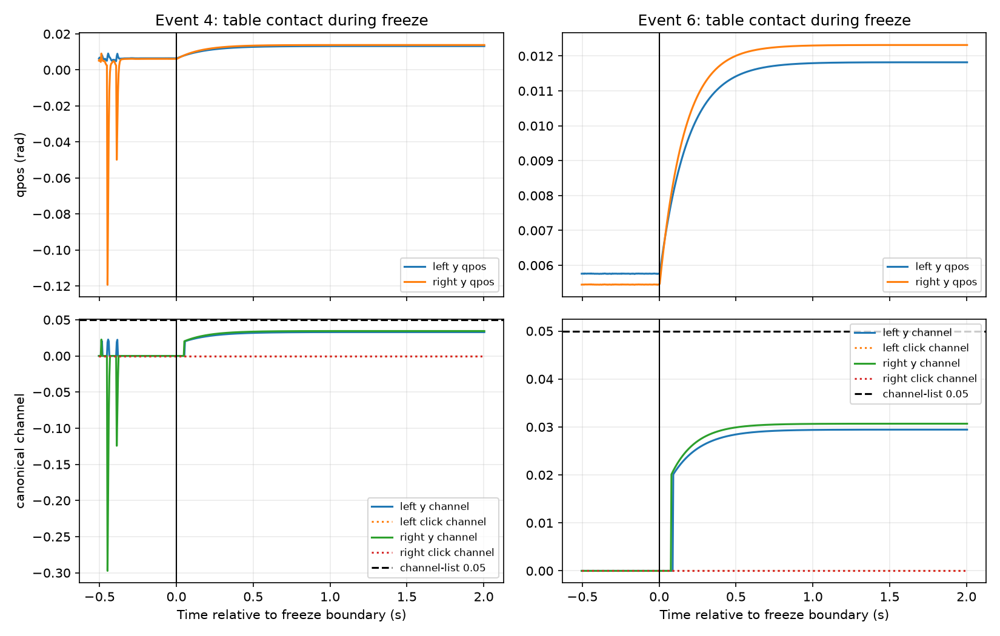
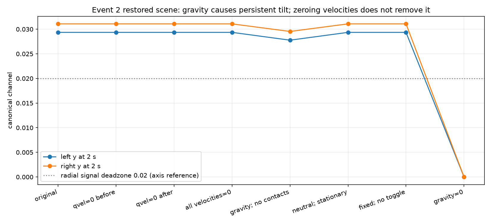
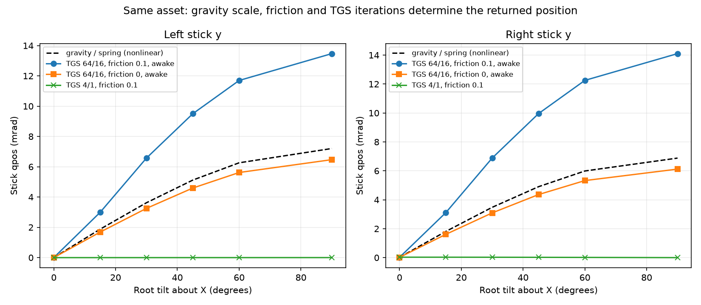
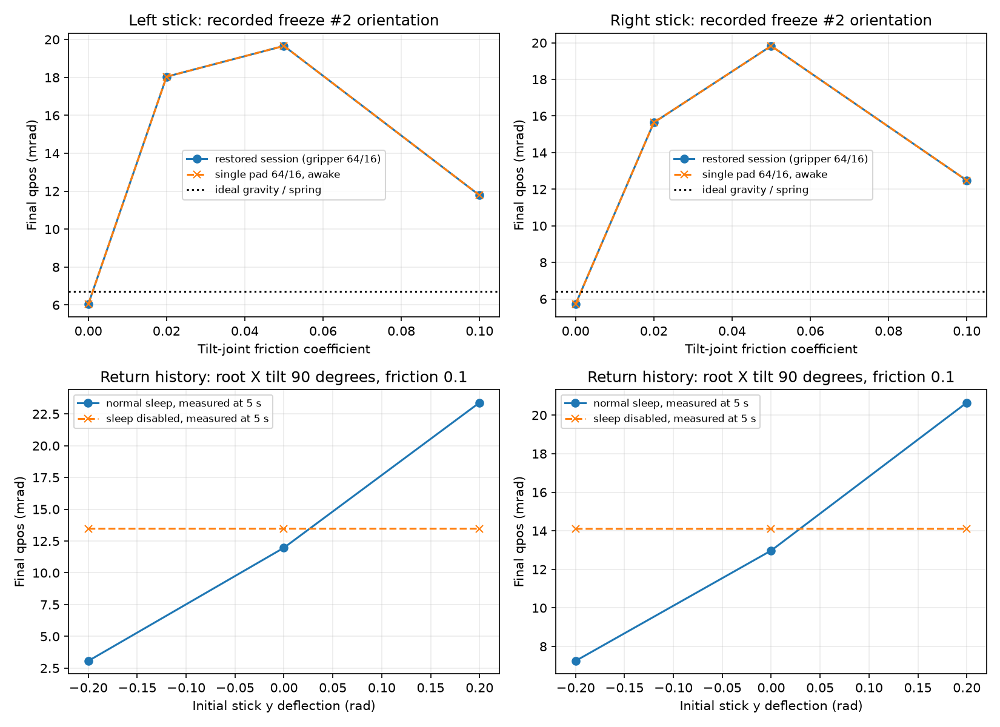

# 冻结手柄后双摇杆点亮：调查报告（2026-10-13）

> **存档说明（2026-10-13）**：这是调查报告的仓库存档副本，只保留正文和 5 张图。报告里引用的数据文件、脚本和压缩轨迹仍在原实验目录 `build/experiments/teleop_freeze_sticks_debug_20261013/`（不进 Git，可能被手动清理）。节点路径和本机路径已替换为占位符。负责人决定暂不处理此问题（见 `docs/plan.md` 第 4 节），原因是预计很少有场景会在运行中动态切换手柄的冻结状态。

> **负责人决定（第二轮）：overlay 必须忠实反映上游信号，不改任何显示阈值；第 5 节建议 1 不采纳。该建议仅保留作历史，本轮结论与建议见“续：物理原因”。**

**结论：今天的记录中的“双摇杆点亮”主要是偏转高亮，不是双摇杆按下，也不是必须由悬空运动惯性引起。** 唯一非空会话有 3 次冻结、3 次解冻；1 次悬空冻结和 2 次桌面接触冻结都在约 0.03 的偏转信号上持续高亮，冻结后前 2 s 的左右 click 信号均为零。成功恢复会话状态的对照实验表明：清零关节或全部速度仍会偏转；无初始偏转、无速度甚至不切换根类型也会偏转；关闭重力后消失。证据支持“当前模型在倾斜固定姿态下的重力与关节求解响应越过 0.02 信号死区，再被 SVG 的极低高亮阈值放大”为主要原因。实际求解器内部为什么形成该偏转仍未定位到 PhysX 某一函数；不能把它写成已确认的引擎缺陷。

## 数据范围与方法

- 原始目录：`<TELEOP_REMOTE_ROOT>/`。按站点的 `<站点登录 profile>` profile 以密钥登录，先执行 `nvidia-smi`。未操作其他进程，未使用硬件 IO，未安装依赖或下载资产。
- 今天的 `live-*` 共 6 个：`170901/180748/205221` 没有 `record.jsonl`；`175107/175608` 是空记录；只有 `live-20261013-202403` 非空。完整读取固定前缀 **7,529,642,153 字节、472,000 步**（step 0–471999），末尾模拟时间 1888.000089675 s。扫描起止 UTC 为 11:56:15–11:59:47；起止文件大小相同。后续新写入或新会话不在这个截止范围内。
- JSONL 在节点逐行处理，只带回各事件前约 0.5 s、后约 2 s 的压缩片段和汇总，不拷回整份记录。额外提取第 2 事件后 3–6 s 的片段，以区分后来的真实按压。原记录未改写、移动或删除。
- 物理 dt 记录为约 0.004 s。事件表使用 **切换边界时间＝前一行的 `sim_time_end_s`**；含 transition 的当前行已经执行了一个物理步。此报告统一使用模拟秒，不从会话目录名推算墙钟时间。
- 初始代码检查及 GPU 节点相关源码留有只读内容快照；重现使用既有 SAPIEN 3.0.3 环境和 `ruling19/resources`，CPU 物理、无渲染系统。新脚本及结果只写本任务目录；没有修改仓库代码、配置或原有文档，也没有 commit。

## 1. 所有冻结和解冻事件、支撑与根速度

下表的接触是记录中的接触流形对数，不等于有正向承托冲量。速度均取切换前；单位分别为 m、m/s、rad/s。姿态和完整速度向量见 `events.json`、`metrics.json`。

| 事件 | 动作 | step | 边界模拟 s | 位置/支撑判定 | 桌面接触对（前） | 桌面接触对（后） | 根 z m | \|v\| m/s | \|ω\| rad/s |
| --- | --- | --- | --- | --- | --- | --- | --- | --- | --- |
| 1 | 解冻 | 82370 | 329.48002 | 桌面附近，无接触（初始固定姿态） | 0 | 0 | 0.030358976 | 0 | 0 |
| 2 | 冻结 | 91672 | 366.68802 | 空中 | 0 | 0 | 0.1604649 | 0.0080022436 | 0.39547852 |
| 3 | 解冻 | 98684 | 394.73602 | 空中 | 0 | 0 | 0.1604649 | 0 | 0 |
| 4 | 冻结 | 99158 | 396.63202 | 桌面接触 | 1 | 1 | 0.051610943 | 0.0026469746 | 0.050202551 |
| 5 | 解冻 | 100194 | 400.77602 | 桌面接触 | 1 | 1 | 0.051610939 | 0 | 0 |
| 6 | 冻结 | 100499 | 401.99602 | 桌面接触 | 1 | 1 | 0.04207281 | 0.0010709187 | 0.022561889 |

第 1 事件的无桌面接触发生在原始固定摆放姿态，根 z≈0.03036 m，不能仅凭“无接触”解释成已经被举高。第 2 事件是在 z≈0.16046 m 的空中，由夹爪接触壳体；第 3 事件是在同一空中固定姿态解冻，切换前没有外部接触。第 4、6 事件冻结前均有 `gamepad/controller_body ↔ table` 接触；第 5 事件在桌面接触状态解冻。三次冻结后根部线速度和角速度均记录为零，根位姿基本保持。

复核冻结逻辑：`teleop/gamepad.py:21–38` 原位切换 `art.root.joint.type` 的 `free/fixed`，仅解冻分支清零根速度，冻结没有 `set_qvel`。`teleop/session.py:126–136,185–235` 确认逐物理步记录 20 关节位置、具名驱动目标、qvel、根速度、21 通道、32 项 canonical_state 和接触。`signals` 的 21 项与 canonical 的前 21 项在所有冻结窗口中逐值完全一致。

## 2. 点亮规则、关节轨迹、持续时间与回中

### 两种点亮规则不能混为一谈

| 位置/路径 | 输入 | 实际规则 |
| --- | --- | --- |
| teleop 通道列表，`teleop/web/app.js:39` | 各通道 | `Math.abs(value) > 0.05` 加 `on` 类 |
| research SVG 摇杆/环，`canonical_adapter.mjs:107–121` | `left_x/left_y`、`right_x/right_y` | `hypot(x,y) > 1e-4` 加 `signal-active`，CSS 强制黄色及光晕 |
| 信号控制器 | 摇杆两个转动关节 | 按 ±0.401425727 rad 范围归一化；二维径向死区为 0.02，死区内置零、外面不重新缩放 |
| SVG click 填色，`gamepad-input-sources.js:406–407,463–466` | `left_stick/right_stick → LS/RS` | 当前调用 `setPressAmount`，按连续 [0,1] 值填色。并没有经过通道列表的 0.05 阈值 |

renderer 的 `setInputAmount` 存在数字阈值（app 默认 20%=0.2，renderer 独立构造默认 0.5），但当前 LS/RS 调用链使用 `setPressAmount`，不能把这两个阈值误报为实际 click 填色判据。当前 iframe 查询参数是 `source=canonical&theme=research`，未覆盖数字阈值。对本次现象，click=0 已足以排除 click 填色。

SVG 在 0.03 偏转时会把整根摇杆及环高亮，而列表不会亮；用户看到的“同时点亮”与这条路径一致。这里没有浏览器像素录像，因此“负责人看到的就是哪一帧”不能独立确认；记录和实际代码路径已经给出了能产生该视觉结果的输入。

### 三次冻结的持续状态

下表是冻结后 2 s 的实测信号以及首个 SVG 偏转高亮样本。持续区间按 4 ms 样本计算，最后一行是记录截断的下界；未把下一次解冻后的新物理过程算进冻结持续时间。

| 事件 | 左首次亮 s | 右首次亮 s | left_x | left_y | right_x | right_y | left_stick | right_stick | 冻结段长度 s | 段末 |
| --- | --- | --- | --- | --- | --- | --- | --- | --- | --- | --- |
| 2 | 0.060000003 | 0.064000003 | -0.0025937603 | 0.029357246 | -0.002814671 | 0.031083295 | 0 | 0 | 28.048001 | 未回信号零点 |
| 4 | 0.056000003 | 0.052000002 | -6.4588047e-07 | 0.032911501 | -5.8706125e-06 | 0.034444618 | 0 | 0 | 4.1440002 | 未回信号零点 |
| 6 | 0.092000004 | 0.080000004 | 1.7135817e-06 | 0.029444556 | -1.8714138e-05 | 0.030679247 | 0 | 0 | 1486.0041 | 未回信号零点 |

全冻结段另以流式信号扫描核对，左右 SVG 各只有一个连续激活区间，没有中途熄灭；下表持续时间按激活样本数×dt计算。`activation_runs.json` 保留起止 step 和时间。

| 事件 | 左高亮采样持续 s | 右高亮采样持续 s | 中途熄灭 |
| --- | --- | --- | --- |
| 2 | 27.992001 | 27.988001 | 无 |
| 4 | 4.0920002 | 4.0960002 | 无 |
| 6 | 1485.9161 | 1485.9281 | 无 |

三个窗口均没有 `gamepad/left_stick` 或 `gamepad/right_stick` 的外部接触。六个摇杆关节的驱动目标在整个窗口内未变：四个转动目标均 0 rad，两个 click 目标均约 −6×10⁻⁶ m。驱动目标为负的小预载是原资产设置，本调查没有改它。

第 2 事件冻结后约 3.760 s 才另有右 click 激活（大于 0.05），到约 4.664 s 为止，累计 0.908 s，峰值 0.97929；同一时间有 `main/fl_link6 ↔ gamepad/right_stick` 接触。这是之后夹爪实际碰到右摇杆，不能计为冻结瞬间的“双 click”。全冻结段右 x/y 也因此短暂超过 0.05；左 click 整段仍为零。证据见 `event_002_delayed_contact.jsonl.gz`。

解冻后的回中：第 3 事件左信号在约 1.516 s 后变为零、右信号约 1.520 s 后变为零，之后才发生第 4 事件的新冻结；解冻后还有跌落/碰撞引起的较大短时偏转（窗口峰值左 x=0.31152、左 y=−0.43486、右 x=0.23831、右 y=−0.39820）。第 5 事件左信号到约 0.148 s 后回零，右信号在约 0.008 s 回零，直到第 6 事件的新冻结。这里“回中”指信号回零，原始关节仍可能在 0.02 径向死区内存在微小偏移，不声称机械坐标严格为零。

### 每次冻结的六关节位置、速度与通道

以下位置和速度按 `前一物理步 / 冻结后首步 / +0.1 s / +0.5 s / +2 s` 顺序列出；转动单位 rad、rad/s，click 单位 m、m/s。完整 20 关节、所有 21 通道的这些采样和冻结段末值见 `joint_samples.csv`、`signal_samples.csv`；连续波形见压缩窗口。

#### 冻结事件 2

| 关节 | 位置 q（前/首/0.1/0.5/2） | 速度 qvel（同顺序） | 目标 |
| --- | --- | --- | --- |
| left_stick_x | -0.0029549291 / -0.0028601612 / -0.002192019 / -0.0012119467 / -0.0010412021 | 1.864702 / 7.8231096e-08 / 5.5879354e-09 / -2.7939677e-08 / 1.6298145e-08 | 0 |
| left_stick_y | 0.0061998791 / 0.0061973864 / 0.0084670139 / 0.011406763 / 0.011784754 | -0.61873662 / -1.3038516e-07 / -2.4214387e-07 / 8.5681677e-08 / -3.1664968e-07 | 0 |
| left_stick_click | 0 / 0 / 0 / 0 / 0 | -0.00037425524 / -0.00014460055 / -0.00036876564 / -3.4314289e-06 / -4.2200554e-09 | -6.0000002e-06 |
| right_stick_x | -0.0027163445 / -0.0026349649 / -0.0020436379 / -0.0012440277 / -0.0011298814 | 1.7348349 / -7.8231096e-08 / -1.0523945e-07 / 1.816079e-08 / 9.1269612e-08 | 0 |
| right_stick_y | 0.0056723985 / 0.0058054784 / 0.0087116072 / 0.012128109 / 0.012477634 | -0.12004215 / 7.4505806e-09 / -3.7252903e-09 / -2.1606684e-07 / -1.7881393e-07 | 0 |
| right_stick_click | 0 / 0 / 0 / 0 / 0 | -2.8916285e-05 / -0.00043354023 / -0.00036055443 / -0.00039307796 / -0.00037114345 | -6.0000002e-06 |

| 通道 | 值（前/首/0.1/0.5/2） | 后 2 s 最大绝对值 |
| --- | --- | --- |
| left_x | 0 / 0 / -0.0054605843 / -0.0030191057 / -0.0025937603 | 0.0060630712 |
| left_y | 0 / 0 / 0.021092355 / 0.028415626 / 0.029357246 | 0.029357248 |
| right_x | 0 / 0 / -0.005090949 / -0.0030990235 / -0.002814671 | 0.005559426 |
| right_y | 0 / 0 / 0.021701666 / 0.030212585 / 0.031083295 | 0.0310833 |
| left_stick | 0 / 0 / 0 / 0 / 0 | 0 |
| right_stick | 0 / 0 / 0 / 0 / 0 | 0 |

#### 冻结事件 4

| 关节 | 位置 q（前/首/0.1/0.5/2） | 速度 qvel（同顺序） | 目标 |
| --- | --- | --- | --- |
| left_stick_x | 1.8350648e-06 / 1.7995754e-06 / 1.041064e-06 / -7.7665888e-08 / -2.5927304e-07 | 0.016825547 / -1.3778845e-09 / 4.0927262e-12 / 2.6119551e-11 / -5.2182259e-11 | 0 |
| left_stick_y | 0.0064655216 / 0.0064730821 / 0.0092261536 / 0.012783042 / 0.013211523 | -0.6645546 / -6.7055225e-08 / -3.7252903e-08 / 1.3411045e-07 / -2.1606684e-07 | 0 |
| left_stick_click | 0 / 0 / 0 / 0 / 0 | -0.00015269854 / -0.00032239605 / -6.6096545e-06 / -5.5831624e-06 / -0.00032210542 | -6.0000002e-06 |
| right_stick_x | -2.0887783e-06 / -2.1006213e-06 / -2.2068291e-06 / -2.337443e-06 / -2.3566149e-06 | 0.017547313 / -1.0195436e-09 / -3.5470293e-11 / 1.6370905e-11 / -2.6375346e-11 | 0 |
| right_stick_y | 0.0061254008 / 0.0061580273 / 0.0096318731 / 0.013497113 / 0.013826956 | -0.66700184 / -1.3411045e-07 / 1.2293458e-07 / 8.1956387e-08 / 2.0116568e-07 | 0 |
| right_stick_click | 0 / 0 / 0 / 0 / 0 | -0.00046158995 / -0.00037401487 / -0.00037946357 / -1.4446559e-05 / -0.00033911807 | -6.0000002e-06 |

| 通道 | 值（前/首/0.1/0.5/2） | 后 2 s 最大绝对值 |
| --- | --- | --- |
| left_x | 0 / 0 / 2.5934163e-06 / -1.9347511e-07 / -6.4588047e-07 | 3.352692e-06 |
| left_y | 0 / 0 / 0.022983464 / 0.031844103 / 0.032911501 | 0.032911501 |
| right_x | 0 / 0 / -5.497478e-06 / -5.822853e-06 / -5.8706125e-06 | 5.8934855e-06 |
| right_y | 0 / 0 / 0.02399416 / 0.03362294 / 0.034444618 | 0.034444618 |
| left_stick | 0 / 0 / 0 / 0 / 0 | 0 |
| right_stick | 0 / 0 / 0 / 0 / 0 | 0 |

#### 冻结事件 6

| 关节 | 位置 q（前/首/0.1/0.5/2） | 速度 qvel（同顺序） | 目标 |
| --- | --- | --- | --- |
| left_stick_x | 1.2406923e-06 / 1.2337642e-06 / 1.0373531e-06 / 7.4777466e-07 / 6.878758e-07 | 0.027540717 / 5.9662852e-10 / 6.8212103e-12 / 6.3664629e-12 / -1.3415047e-11 | 0 |
| left_stick_y | 0.0057617081 / 0.0057618939 / 0.0082356334 / 0.011418571 / 0.011819802 | -0.63703042 / -2.0675361e-07 / 5.9604645e-08 / -1.1920929e-07 / 1.6763806e-07 | 0 |
| left_stick_click | 0 / 0 / 0 / 0 / 0 | 0.00034718032 / -1.0382413e-05 / -0.00027107922 / -0.00029392968 / -2.7648639e-09 | -6.0000002e-06 |
| right_stick_x | -6.2078734e-06 / -6.2349186e-06 / -6.7165333e-06 / -7.375992e-06 / -7.5123367e-06 | 0.024423916 / 9.276846e-11 / -1.0186341e-10 / 3.2741809e-11 / 2.1827873e-11 | 0 |
| right_stick_y | 0.0054502212 / 0.0054741004 / 0.0085744169 / 0.012007426 / 0.012315439 | -0.62492859 / -5.7742e-08 / 3.7252903e-08 / -3.054738e-07 / -5.9604645e-08 | 0 |
| right_stick_click | 0 / 0 / 0 / 0 / 0 | 6.7641959e-05 / -7.235384e-05 / -9.4047282e-06 / -0.00031597324 / -1.23067e-05 | -6.0000002e-06 |

| 通道 | 值（前/首/0.1/0.5/2） | 后 2 s 最大绝对值 |
| --- | --- | --- |
| left_x | 0 / 0 / 2.5841718e-06 / 1.8627971e-06 / 1.7135817e-06 | 2.6177118e-06 |
| left_y | 0 / 0 / 0.020515958 / 0.02844504 / 0.029444556 | 0.029444556 |
| right_x | 0 / 0 / -1.6731696e-05 / -1.8374488e-05 / -1.8714138e-05 | 1.8719752e-05 |
| right_y | 0 / 0 / 0.021359909 / 0.02991195 / 0.030679247 | 0.030679247 |
| left_stick | 0 / 0 / 0 / 0 / 0 | 0 |
| right_stick | 0 / 0 / 0 / 0 / 0 | 0 |

三个冻结事件的 21 项 `signal_delta` **全部严格等于 0**。它是“切换前/切换后、下一物理步之前”的比较，不包含后续求解。成功复现也确认：原始模式在切换瞬间 20 个 qpos、20 个 qvel、20 个 drive target 全部不变；首物理步后内部速度发生明显变化，随后位置逐渐偏向新的状态。这与“setter 立即把摇杆坐标重置或跳到按下位置”的解释不符。

## 3. 悬空与桌面冻结的差异、其他控件

悬空冻结前的根速度更大（事件 2：|v|≈0.0080 m/s、|ω|≈0.3955 rad/s），桌面冻结较小，但**都不是固定保持中的持续双摇杆高亮的必要条件**。三次冻结时根朝向都明显偏离初始水平朝向，两个 y 关节在约 0.5–1 s 内缓慢趋向约 0.012–0.014 rad 的状态；它们的归一化幅度都超过 0.02 死区，低于 0.05 列表阈值。悬空冻结不能与“水平摆放、姿态不变”的桌面冻结直接作单变量比较；此记录中两次桌面冻结同样倾斜。

“位置改变而记录 qvel 接近零”也存在：冻结后 0.02–0.2 s 中 y 关节继续缓慢变化，而步末 qvel 多在 10⁻⁷ rad/s 附近。这是已观测事实；可能与位置求解修正及摩擦有关，尚未取得引擎内部子步数据，不能用 qvel≈0 推断位置已经不动，也不能把位置差分当成已记录的关节速度。

其他控件并非完全没有机械变化。下表列出每个冻结窗口后 2 s 的最大信号幅度（不含摇杆）；全部按钮、肩键、十字键为零。事件 2 的右扳机出现小幅非零，但不足以触发列表高亮。

| 控件/通道 | 事件 2 | 事件 4 | 事件 6 |
| --- | --- | --- | --- |
| left_trigger | 0 | 0 | 0 |
| right_trigger | 0.00099310299 | 0 | 0 |
| south | 0 | 0 | 0 |
| east | 0 | 0 | 0 |
| west | 0 | 0 | 0 |
| north | 0 | 0 | 0 |
| back | 0 | 0 | 0 |
| guide | 0 | 0 | 0 |
| start | 0 | 0 | 0 |
| left_shoulder | 0 | 0 | 0 |
| right_shoulder | 0 | 0 | 0 |
| dpad_up | 0 | 0 | 0 |
| dpad_down | 0 | 0 | 0 |
| dpad_left | 0 | 0 | 0 |
| dpad_right | 0 | 0 | 0 |

三个冻结后 2 s 窗口的所有按钮滑动及两根 click 位置均为零，但记录 qvel 可非零：例如事件 2 左/右 click 的最大速度绝对值为 0.000379/0.000434 m/s。右扳机位置峰值约 0.0002933 rad，十字键 vertical 在事件 2 约 0.000150–0.000158 rad；具体 min/max/qvel 峰值已在 `metrics.json` 按全部 20 关节给出。十字键还经过 0.3 的触点闭合阈值，故小幅摇摆不输出；不能据 overlay 不亮断言物理关节没有响应。本记录没有支持“其他按钮同样出现持续大信号，只是不显眼”的证据。

## 4. 原因、对照实验和证据强度

### 已执行的主要实验

`reproduce_contacts_remote.py` 在既有 SAPIEN 3.0.3 环境中创建 CPU-only 场景，复用同一资源与 Session/夹爪设置，把每次冻结前的根位姿、20 个 qpos/qvel/目标、主夹爪位姿/速度、控制目标恢复到新场景。记录原会话的“先固定”初始化；所有模式运行 500 步、2 s。不是重放 47 万步，也不保留接触缓存；原始对照与原记录的末态差异用下表明确给出。每个事件 9 种条件，共 **27 个主要对照**，另有 30 个无夹爪初始化对照（见后面的限制）。

各模式只改变表中条件；其余使用同一前状态、资源、dt 与 PD。`gravity_only` 同时屏蔽夹爪碰撞、移除桌面、把根平移至 z=1 m，保持朝向。`neutral_fixed_no_toggle` 保持初始 fixed，设 20 个内部位置和速度及根速度为零，以记录朝向放置，完全不执行 G 切换；夹爪仍按记录目标驱动。

#### 对照事件 2：2 s 的左右 y 信号

| 条件 | left_y | right_y | 与记录最大轴差 |
| --- | --- | --- | --- |
| original | 0.029357267 | 0.031083291 | 2.0880334e-08 |
| zero_joint_before | 0.029357264 | 0.031083293 | 2.1460343e-08 |
| zero_joint_after | 0.029357264 | 0.031083293 | 2.1460343e-08 |
| zero_all_before | 0.029357264 | 0.031083293 | 2.1460343e-08 |
| no_gripper_contacts | 0.027771173 | 0.029542549 | 0.0015860725 |
| zero_gravity | 0 | 0 | 0.031083295 |
| gravity_only | 0.027771159 | 0.029542584 | 0.0015860864 |
| neutral_stationary | 0.029356949 | 0.031083467 | 5.1185818e-07 |
| neutral_fixed_no_toggle | 0.029356949 | 0.031083467 | 5.1185818e-07 |

#### 对照事件 4：2 s 的左右 y 信号

| 条件 | left_y | right_y | 与记录最大轴差 |
| --- | --- | --- | --- |
| original | 0.032976599 | 0.034476173 | 6.509792e-05 |
| zero_joint_before | 0.032976613 | 0.03447619 | 6.5111841e-05 |
| zero_joint_after | 0.032976613 | 0.03447619 | 6.5111841e-05 |
| zero_all_before | 0.032976613 | 0.03447619 | 6.5111841e-05 |
| no_gripper_contacts | 0.031066642 | 0.03291819 | 0.0018448587 |
| zero_gravity | 0 | 0 | 0.034444618 |
| gravity_only | 0.031066651 | 0.032918094 | 0.0018448494 |
| neutral_stationary | 0.032976186 | 0.034476006 | 6.4684954e-05 |
| neutral_fixed_no_toggle | 0.032976186 | 0.034476006 | 6.4684954e-05 |

#### 对照事件 6：2 s 的左右 y 信号

| 条件 | left_y | right_y | 与记录最大轴差 |
| --- | --- | --- | --- |
| original | 0.029448479 | 0.030680846 | 3.9231827e-06 |
| zero_joint_before | 0.029448479 | 0.030680855 | 3.9231827e-06 |
| zero_joint_after | 0.029448479 | 0.030680855 | 3.9231827e-06 |
| zero_all_before | 0.029448479 | 0.030680855 | 3.9231827e-06 |
| no_gripper_contacts | 0.027752648 | 0.029289656 | 0.0016919079 |
| zero_gravity | 0 | 0 | 0.030679247 |
| gravity_only | 0.027752687 | 0.029289422 | 0.0016918685 |
| neutral_stationary | 0.029448182 | 0.030680859 | 3.626218e-06 |
| neutral_fixed_no_toggle | 0.029448182 | 0.030680859 | 3.626218e-06 |

原始恢复对照的左右 click 均为零；四个偏转轴与原记录后 2 s 值的最大差见表：事件 2 约 2.1×10⁻⁸，事件 4 约 6.51×10⁻⁵，事件 6 约 3.92×10⁻⁶，均远小于约 0.03 的偏转。恢复新场景不复用接触缓存，因此不声称逐步完全一致。三次冻结的一致结果如下：

- 冻结前清零 qvel、切换后清零 qvel，或切换前清零根部与全部关节速度，都不能消除约 0.03 的持续偏转。该结果推翻“未清零速度是本次持续点亮的必要原因”，但不排除速度影响瞬态或其他动作。
- 在相同姿态、qpos=qvel=根速度=0 的条件下也会偏转；从初始 fixed 保持不切换同样偏转。切换冲击、摇杆既有偏转、非零初始速度都不是必要条件。
- 屏蔽夹爪接触仍偏转；连桌面也移除、升高到空中后仍偏转。直接压杆、桌面冲击和外部接触不是必要条件。原始有接触与无接触对照的幅度有小差别，不能说接触对结果完全没有影响。
- 只把重力改成零时，四个偏转通道和两个 click 通道均归零。对这组可复现条件，重力是形成持续偏转的必要因素。

### 候选原因的结论

| 候选解释 | 状态 | 能区分它的证据/实验 |
| --- | --- | --- |
| 悬空运动惯性、冻结瞬间急停是持续点亮主因 | 不支持作为必要原因 | 桌面同样亮；零全部速度和无 G 切换仍亮。瞬态惯性贡献未被否认 |
| 根类型 setter 立即重置/跳变 qpos 或 drive targets | 对本次未观察到 | `signal_delta=0`；成功复现切换前后 qpos/qvel/targets 完全一致；后续逐步变化 |
| controller 自行合成/锁存双 click | 排除本次主要现象 | controller 纯读关节位置、编码，不依据 frozen 修改值；click=0；canonical 与 signals 一致 |
| 夹爪/桌面直接压杆 | 排除作为必要原因 | 三个冻结窗口无摇杆接触；屏蔽全部外部碰撞仍出现。第 2 事件后来右 click 有独立直接接触 |
| 倾斜姿态、重力与当前关节求解/驱动模型形成非零偏转 | 主要原因得到对照支持 | 恢复场景可重现；零重力消失；无速度、无切换、无外部接触仍出现 |
| 某个特定 PhysX 缓存、摩擦实现或位置积分缺陷 | 尚未证实 | 未采集内部子步力/约束修正；最小新加载场景结果有初始化差异，见下 |
| SVG 把较小偏转画成很明显的点亮 | 已确认代码事实 | `hypot > 1e-4` 的 yellow/glow，与列表 0.05 不同；信号死区外约 0.03 就触发 |

### 数值与模型适用范围

资源将参数标为 `estimated`、非硬件校准；本报告中的关节响应是当前模拟资产行为，不是 Xbox 实物测量。摇杆转动 drive 的当前 stiffness≈0.03487569 N·m/rad、damping≈0.0002338484 N·m·s/rad、force_limit≈0.024 N·m，joint friction≈0.1 为既有模拟设置；目标 0 rad。这些值从实际已加载关节和资源快照读取，仅解释既有行为，没有新采纳物理参数。

最先执行的单手柄、直接以记录倾斜朝向新加载的隔离对照未复现偏转（完整 30 个条件见 `reproduction.json`、`repro_*.jsonl.gz`）；加入会话的初始水平姿态与完整恢复流程后，27 个主要对照成功重现。因初始化流程不同，单手柄负结果不能用来否定原记录，也不能证明重力在所有初始化方式下都造成相同偏转。初始化差异的具体引擎内部原因仍待确认。早期默认 `Scene()` 创建了渲染系统并遇到设备资源错误；最终脚本显式只创建 `PhysxCpuSystem`，后续实验全部完成，日志保留该失败过程。

查阅的一手资料：NVIDIA 的 [PhysX Articulations](https://nvidia-omniverse.github.io/PhysX/physx/5.1.1/docs/Articulations.html) 描述浮动/固定根及关节驱动/摩擦；[setArticulationFlag API](https://nvidia-omniverse.github.io/PhysX/physx/5.1.0/_build/physx/latest/class_px_articulation_reduced_coordinate.html) 要求在 simulation 外调用，并说明固定和浮动 articulation 的内部关节 DOF 数不包含根的 6 DOF；[SAPIEN 当前公开源码](https://github.com/haosulab/SAPIEN/blob/master/src/physx/articulation_link_component.cpp) 的 root setType 设置 `eFIX_BASE`。这些文档说明机制边界，不证明某个 3.0.3 二进制缺陷；公开 master 也不作为已安装二进制的逐行实现证明。Session 确实在 scene.step 之前切换，记录与复现都没有观察到 DOF 变少。

### 尚未执行、用于定位引擎细节的最小实验

若后续要认定为 PhysX/SAPIEN 缺陷：使用同一原生 URDF、重力和朝向，比较“倾斜朝向直接新加载”和“水平加载并配置完驱动后再改成同一倾斜朝向”，不创建夹爪/桌面；同时读取真实 link/COM 姿态、joint anchor、被动力、每个物理子步的速度和位置修正。如果姿态/参数相同而重力响应不同，支持初始化/缓存路径问题；若它们不同，应先定位构建/姿态同步差异。再固定 pose 和重力，单独把 tilt friction 从当前 0.1 改成 0（仅实验），测最终偏转和位置校正：消除慢变/残留支持摩擦相关响应，否则转查驱动和质量分布。**这两个进一步细分实验未执行，本报告不把它们的预期结果当成事实。**

## 5. 修复建议及风险（未实施）

1. **先决定高亮语义，并统一视觉阈值。** 若“亮”意味着明显输入，建议 SVG 偏转高亮采用与通道列表一致的判据（例如任一轴绝对值 >0.05），并把偏转与 click 的视觉状态区分清楚。不要把径向 0.05 和“任一轴 >0.05”当成相同规则。风险：小于阈值的真实细微偏转不再被高亮；信号本身仍存在，这只能解决视觉误解，不解决物理偏转。
2. **若冻结期间需要保持完整控件状态，就明确冻结协议。** 当前只冻结根，20 个内部关节仍参与重力/接触求解。可讨论显式固定内部关节位置的 inspection 模式，或保存快照并暂停该 articulation 的动态更新；解冻时恢复明确的状态。风险：冻结期间按键/摇杆不再可被夹爪推动，接触反力与现有语义改变。不能把“冻结根”悄悄改成“冻结全手柄”。
3. **若要求根固定、内部控件仍动态可操作，优先核查重力平衡与初始化流程，再考虑重力补偿。** 使用姿态相关的被动力/关节重力补偿有可能消除无输入偏转；应先证明重力响应一致，再在倾斜角扫描、悬空/桌面/按压和解冻过程中验证。风险：误补偿掩盖 COM/惯量/姿态同步问题，补偿过强会改变真实按压力与回中。没有实物证据时，不建议直接增大 stiffness 或 friction 并称为已校准。
4. **不建议把“冻结时清零 qvel”作为本问题的主要修复。** 本次清零前/后、全速度清零均未解决。它可能改善部分瞬态，但会抹去合法内部运动；如果采用，应有明确的急停语义与对应验证，不能宣称已解决持续点亮。
5. **不建议仅提高 0.02 信号死区或强制输出零。** 这会掩盖实际机械偏转，并可能影响既定游戏/操控信号语义。若确需改变，应以本任务的倾斜固定、自由运动、受控按压对照测量误报率和小输入损失，再由负责人选择；本调查没有改死区。

建议的验收对照：同一初始姿态、同一夹爪目标、同一 dt，比较修改前后冻结/解冻的 qpos、qvel、drive targets、21 通道及接触；至少包括本报告的空中姿态、两种桌面姿态、初始水平姿态、真实 stick click。视觉阈值更改验收只看高亮语义与信号未被改写；物理更改另看回中、按压和反力，二者分别判定。

## 我自行做出的选择

- 把“今天”解释为目录名 `live-20261013*` 的记录，并明确字节截止；没有从未来偏移的目录时分秒推算事件墙钟时间。
- 单独标注初始桌面附近但无接触的事件，避免用根高度或接触缺失单独推断被夹爪提起。
- 同时检查 SVG 与通道列表，复核 click 实际调用链，未沿用“所有 overlay 都是 >0.05”的简化说法。
- 先分析记录，再开展能区分惯性、速度残留、重力、接触、根类型切换的对照；使用已有 CPU 物理环境，无依赖安装、GPU 渲染或他人进程操作。
- 用成功恢复会话的原始条件是否匹配记录来判断实验有效性，保留不匹配的初期结果，未把负结果写成现场原因已排除。
- 只画 3 张图，保留连续窗口、具名速度、所有关节与通道采样为机器可读证据；未更改代码、配置、资产、原记录或其他任务目录。

## 关键证据文件与复跑

- `inventory.json`：记录清单、读取字节范围和截止时间。
- `events.json` / `events.csv`：全部 6 个事件、前/后状态、冻结段末状态和全段通道统计。
- `activation_runs.json`：全冻结段 SVG 高亮及 click >0.05 的连续区间。
- `metrics.json` / `joint_samples.csv` / `signal_samples.csv`：三次冻结的全 20 关节范围、六摇杆关节与 21 通道采样。
- `event_002/004/006_window.jsonl.gz`：原记录提取的连续冻结窗口；另保留 001/003/005 解冻窗口。
- `event_002_delayed_contact.jsonl.gz`：冻结后真正右 click 接触的独立时间段。
- `contact_reproduction.json` / `contact_repro_*.jsonl.gz`：27 个成功恢复场景对照及连续输出；`contact_reproduction_final.log` 为执行日志。
- `reproduction.json` / `repro_*.jsonl.gz`：30 个不同初始化隔离对照及输出，作为实验适用范围证据。
- `source_snapshot_remote.json` / `source_snapshot_local.json` / `overlay_wiring_snapshot_remote.json` / `resource_snapshot.json`：调查时源码与参数内容快照，不是原目录修改。
- `extract_remote.py`、`extend_evidence_remote.py`、`reproduce_remote.py`、`reproduce_contacts_remote.py`、`remote_ops.py`、`analyze_report.py`：本任务脚本。GPU 结果目录为 `<TELEOP_REMOTE_ROOT>/teleop_freeze_sticks_debug_20261013/`；脚本从本地通过 profile 的 stdin 执行。

已有提取数据生成报告：`<本地项目 Python> build/experiments/teleop_freeze_sticks_debug_20261013/analyze_report.py`。重新扫描原记录会改变截止点，应单独记录新的 inventory，不能混用原结论的截止范围。

## 续：物理原因（第二轮调查，2026-10-13）

**结论：本次约 0.03 的摇杆偏转信号，主要由重力载荷下的 PhysX TGS 旧式关节摩擦、隐式回中驱动与实际求解迭代数的耦合决定，置信度高。** 质量、COM 和刚度决定基本重力偏转尺度，但单纯的重力矩/刚度只预测约 0.0067 rad；原会话约 0.0118 rad 的结果明显受到数值求解条件影响。保持相同模型和重力，只降低夹爪迭代数就使偏转接近零；恢复手柄的高迭代数又使偏转回来。摩擦扫描非单调，不能概括为“摩擦越大、越回不了中”。默认睡眠下出现的释放方向差异，在禁止睡眠并运行 5 s 后几乎消失，故没有证据把本次长期偏转解释为稳定的、取决于释放方向的普通静摩擦滞回。

**负责人决定：overlay 必须忠实反映上游信号，保持所有显示阈值；原第 5 节建议 1 不采纳。** 本轮所有改变均仅存在于新建实验场景，未改 overlay、信号死区、仓库代码、配置或资产，也未实施任何修复。原第 4 节“尚未执行”是第一轮的截止状态；本节给出本轮已执行的更新证据。

### 本轮范围与观测口径

沿用同一 `ruling19/resources/robotwin/full_controls/mobility.urdf`、SAPIEN 3.0.3 既有环境、CPU 物理及原会话恢复流程。密钥 profile 登录后先运行 `nvidia-smi`，没有操作其他进程、安装依赖或硬件 IO。新增脚本仅在本任务目录中。这里把以下 5 项要求全部安排为实际运行的对照；需要区分“公开物理步的数据已读取”与“内部 TGS 迭代数据不由此 Python API 暴露”。

共纳入 234 组结果：初始化 6、迭代数 8、观测调用 4、倾角/摩擦/释放方向组合 144、禁止睡眠 36、恢复场景/摩擦 8、外部子步 8、PGS 12、两种会话运动流程各 1、同为 5 s 的默认睡眠释放对照 6。数值结果 JSON 无损 gzip 压缩，解压内容不变，避免重复元数据使产物超过 50 MB。第一轮记录和结果保留。

位置和速度均读取 API 原始值。`compute_passive_force(gravity=True, coriolis_and_centrifugal=False)` 返回的是**抵消重力所需的广义力**，其符号与实际重力矩相反，并不包含所有驱动/摩擦力。另独立从 URDF FK、真实 link 质量、COM 和关节轴计算重力矩，不能把 API 结果当作已测得的摩擦矩。

### 1. 初始化路径、真实几何与会话运动

- (a) 直接以冻结事件 2 的倾斜朝向加载，之后配置驱动。
- (b) 以水平朝向加载并配置驱动，再改成相同倾斜朝向；另检查水平先运行 25 步的版本。
- (c) 从原记录解冻前状态恢复，依次执行 9,303 个记录中的夹爪目标/G/Tab 指令，确实夹起并运动到冻结附近姿态；随后使用夹爪目标的闭环微调来对齐朝向，再冻结。闭环不直接改手柄根位姿。

读取全部 link/COM 位姿、质量、惯量、joint parent/child anchor、被动重力项；初始化轨迹另记录摇杆 link/COM、incoming joint wrenches，以及六个关节每步的位置/速度。原最简场景与会话场景并非相同有效求解条件，不能只比较目录或 URDF 名称。

| 路径 | 手柄请求迭代数 | left_y q rad | right_y q rad | 是否睡眠（3 s） |
| --- | --- | --- | --- | --- |
| a_direct | [10, 1] | -1.262022e-08 | 4.037357e-07 | False |
| b_after_config | [10, 1] | -1.262022e-08 | 4.037357e-07 | False |
| b_warm | [10, 1] | -1.262022e-08 | 4.037357e-07 | False |
| a_direct | [64, 16] | 0.010470562 | 0.011363211 | True |
| b_after_config | [64, 16] | 0.010470562 | 0.011363211 | True |
| b_warm | [64, 16] | 0.010470562 | 0.011363211 | True |

(a)/(b) 的质量差为 0 kg，local COM pose 差为 0，joint anchor pose 差为 0。真实 link 位姿与独立 URDF FK 的最大位置差为 6.9604154e-08 m；独立重力矩与 API 重力补偿项的符号相反、最大误差 6.3655113e-11 N·m。没有发现“先配置驱动/后改变朝向”造成的质量、COM 或锚点错配。用相同 10/1 或 64/16 迭代设置时，(a)/(b) 的结果一致。

(c) 从根 z=0.03036 m 提升到最大 z=0.16095918 m，9,303 个重放步均存在夹爪–手柄接触。仅重放目标后，相对原记录的末态位置差约 1.86 mm、朝向差约 1.63°，不是逐步无误差重放；使用夹爪闭环后，朝向误差为 **0.024957964°**，未用手柄根位姿 setter 对齐。冻结后 3 s 左/右 y=0.011785433/0.012478226 rad，仍对应约 0.03 的信号。早期另一组直接 setter 对齐的实验单独保留在 `physics_session_results.json.gz`，不把它称为物理到达目标；正式闭环证据见 `physics_session_servo_results.json.gz` 与 motion/control/final 三个压缩轨迹。

**决定差异的关键对照是迭代数，而不是初始化朝向顺序：**

| 恢复场景条件 | 手柄请求迭代数 | 夹爪请求迭代数 | left_y rad | right_y rad |
| --- | --- | --- | --- | --- |
| original | [10, 1] | [64, 16] | 0.011784791 | 0.012477684 |
| all_4 | [10, 1] | [4, 1] | -3.1922127e-08 | 4.0201837e-07 |
| pad_64_gripper_4 | [64, 16] | [4, 1] | 0.011784791 | 0.012477684 |
| remove_gripper | [10, 1] | None | -3.1922127e-08 | 4.0201837e-07 |
| no_contacts_gripper_64 | [10, 1] | [64, 16] | 0.011148063 | 0.011859139 |

手柄原请求值实测为 **10/1**，夹爪为 **64/16**。只改夹爪到 4/1，偏转接近零；再只改手柄到 64/16，偏转恢复；从场景中移除夹爪也使偏转接近零。只屏蔽夹爪碰撞却保留其 64/16 请求时，仍可能偏转，不能把“没有接触”自动等同于独立低迭代求解。

NVIDIA [求解岛管理文档](https://nvidia-omniverse.github.io/PhysX/physx/5.4.1/docs/Simulation.html#island-management) 说明实际迭代数取岛内较高请求值，小岛也可能为性能而合并。这里的请求值读取与因果干预已经验证；Python API 不提供实际岛 ID/每岛迭代计数，因此“夹爪使手柄进入高迭代求解条件”是得到对照与文档支持的机制解释，未声称读到了某一岛的内部计数。

### 2. 摩擦：固定原记录朝向与重力的扫描

恢复事件 2 的原始状态、目标与夹爪，只改变四个 tilt joint 的摩擦；没有改 click 摩擦、质量、COM、回中刚度、阻尼或信号映射。3 s 的原始位置与当前上游编码如下：

| 摩擦系数 | left_y rad | right_y rad | left_y 信号 | right_y 信号 |
| --- | --- | --- | --- | --- |
| 0 | 0.0060397801 | 0.0057159858 | 0 | 0 |
| 0.02 | 0.018040525 | 0.015642313 | 0.044941127 | 0.038966805 |
| 0.05 | 0.019662431 | 0.019829294 | 0.048981607 | 0.049397158 |
| 0.1 | 0.011784791 | 0.012477684 | 0.029357339 | 0.031084261 |

表中信号取同姿态、64/16、禁止睡眠的匹配单手柄对照；原恢复场景和该对照的 q 差在数值精度范围内。摩擦为零时机械位置仍有约 0.006 rad 的重力偏转；信号为零是原有 0.02 径向死区的编码结果，**没有改显示或信号阈值，也不能说物理角度已经为零**。

µ=0.02/0.05 的偏转反而比 µ=0.1 更大，因此“降低摩擦一点就能减少偏转”在这里是错误预测。禁止睡眠、无外部接触、单手柄明确设为 64/16，复现同一扫描曲线；此偏转不需要夹爪直接碰到摇杆，也不需要运动冲击。

[PhysX 旧式摩擦 API](https://nvidia-omniverse.github.io/PhysX/physx/5.1.2/_build/physx/latest/class_px_articulation_joint_reduced_coordinate.html) 把该系数定义为无量纲、基于关节传递空间载荷的摩擦限制，不是 N·m 单位的常值摩擦矩。[NVIDIA 关于 TGS/PGS 的说明](https://nvidia-omniverse.github.io/PhysX/physx/5.6.0/docs/Articulations.html#articulation-joint-friction) 明确指出子迭代中的摩擦冲量累积不同，响应可能不同。较新版本 [官方 issue #498](https://github.com/NVIDIA-Omniverse/PhysX/issues/498) 中维护者也确认了旧式模型的这类结构性差异。它们解释本次实验的方向，但没有据此认定已安装二进制就是某个较新 issue 的精确实现或某一代码行缺陷。

### 3. 重力矩、回中驱动与倾角曲线

独立计算使用完整运动子树的真实质量和 COM：

`tau_g,i(q) = sum(axis_i_world · ((COM_j_world - anchor_i_world) × (m_j * [0,0,-9.81])))`

零位线性预测为 `q_i ≈ tau_g,i(0)/k_i`；非线性预测联合迭代四个 tilt 坐标，求 `k_i*q_i = tau_g,i(q)`。阻尼只影响动态回中，不决定理想 v=0 静态角；摩擦和睡眠不能悄悄并入一个“有效刚度”。所有独立算式使用当前完整 URDF，未用旧纵切片的 14 mm COM 代替。

| 当前读取值 | 左 | 右 | 来源/适用范围 |
| --- | --- | --- | --- |
| cap/click link 质量 kg | 0.0040148511 | 0.0035479353 | 实际加载 link；完整资产 |
| 两层 gimbal 合计质量 kg | 0.001 | 0.001 | 每层约 0.0005 kg |
| 总 moving assembly 质量 kg | 0.0050148511 | 0.0045479353 | 非实物称重 |
| cap COM 相对 pivot 的 z m | 0.0063790814 | 0.0068954355 | 完整 meshbase 惯性估计 |
| tilt 刚度 N·m/rad | 0.034875691 | 0.034875691 | 参考力矩/角行程估计 |
| tilt drive 阻尼 N·m·s/rad | 0.00023384842 | 0.00023384842 | full_controls ζ=0.7、I_eff=0.8e-6 kg·m² 估算 |
| 冻结姿态零位 y 重力矩 N·m | 0.00023461006 | 0.00022411443 | 独立 COM/轴计算 |
| 冻结姿态理想 y 角 rad | 0.0067273117 | 0.0064262076 | 不含摩擦/睡眠的静态方程 |

从中心开始，绕根 X 轴扫描 0°、15°、30°、45°、60°、90°；每个角度同时扫描四种摩擦和三种释放初值，并比较 4/1 与 64/16。另对 64/16 中心组禁止睡眠运行 5 s。下表为左 y，右 y 和全部 X 轴见 CSV/结果 JSON。

| 根倾角 ° | 理想 q_y rad | TGS 64/16 µ=0（醒着） | TGS 64/16 µ=0.1（醒着） | TGS 4/1 µ=0.1 |
| --- | --- | --- | --- | --- |
| 0 | -1.8515288e-06 | -1.7258338e-06 | -1.8837335e-06 | -2.7836404e-06 |
| 15 | 0.0018758075 | 0.0016828673 | 0.0029884297 | -2.7161682e-06 |
| 30 | 0.0036229916 | 0.0032508888 | 0.0065736677 | -2.3977789e-06 |
| 45 | 0.0051187129 | 0.0045932303 | 0.0095019201 | -1.9699573e-06 |
| 60 | 0.0062603663 | 0.0056186854 | 0.011698107 | -1.4185337e-06 |
| 90 | 0.0072038274 | 0.0064678295 | 0.013470509 | 1.4183605e-09 |

同一几何/质量模型的理想曲线随重力分量变化，但当前 TGS+µ=0.1 的高迭代结果约是理想角的 1.6–1.9 倍，低迭代结果却几乎为零；所以“质量或 COM 较大、回中刚度不足”并不能独立解释现场值。当前 TGS 无摩擦、4 ms 的值也不是完全满足理想静态方程：事件姿态约 0.00604 rad，理想约 0.006727 rad；PGS 无摩擦约 0.006726 rad，与独立理论接近。

外部时间步从 4 ms 细分到 1 ms，在同一 64/16 条件下的 0.4 s 状态：µ=0 的 y 从约 0.006040 变为 0.006681 rad；µ=0.1 从约 0.010442 变为 0.005335 rad。这些是短窗口状态，不冒充全部组的最终静力态。它再次说明数值时间步和摩擦求解过程实质影响偏转，不能仅靠静力算式给所有求解器配置一个通用预测。

#### 子步速度与位置变化：已读取什么，哪些仍不可读取

已保存公开 4 ms 物理步及主动细分的 1 ms 外部子步，每步有六关节 qpos/qvel、Δq、重力补偿项、驱动 `-k*q-b*qvel` 的瞬时估算，并记录如下观测残差：

`R = q_after - q_before - 0.5*(qvel_before + qvel_after)*dt`

**R 只是端点速度积分与位置变化的不一致量，不是 PhysX 内部记录的位置修正。** 已安装 SAPIEN 3.0.3 没有暴露每次内部 TGS 迭代的 qpos/qvel/position-correction 回调或读回，所以真实内部修正字段保留 null，原因写在 `physics_analysis.json`；本轮没有采到这些内部数据，也没有修改或重编译引擎。

原记录中 qvel≈0 但 qpos 继续变化，在高迭代带摩擦的对照中再次出现。[NVIDIA 隐式驱动说明](https://nvidia-omniverse.github.io/PhysX/physx/5.3.0/_downloads/6acf3afb8f69452757e0e766b5a22978/implicitDrives.pdf) 解释 TGS 会在位置子迭代中推进关节位置；步末速度不能代表每个内部子迭代速度。结合这里的可控迭代数和摩擦响应，位置/速度两阶段的数值耦合是有证据支持的解释，但仍未将某一内部修正项单独归因到某一行代码。若后续必须确证内部项，最小方案是在具备原生观测接口的环境中固定模型/重力/朝向，对 µ=0/0.1、位置迭代 10/64 记录每次内部 drive/friction 冲量和位置推进量；只有这些推进量能解释公开 Δq/R 且随对照改变，才支持具体内部归因，否则转查位置/速度读回口径。该原生内部跟踪本轮未执行。

对 `compute_passive_force` 另做“每步调用/只在端点调用”对照，最终位置相同，排除了每步读取该诊断量制造本次位置差异。无摩擦 TGS 下还可能读到稳定位置配非零步末 qvel，因此本报告也没有凭 qvel≈0 或固定位置就宣布所有组达到了物理静态平衡。

### 4. 先推偏再释放：睡眠造成的表面滞回

在 (b) 条件将左右 y 的 qpos 人为置为 −0.2、0、+0.2 rad，qvel 置零，保持原回中目标不变，再释放；这是坐标置值的可重复推偏，不是硬件或真实手指按压。初值在 ±0.40143 rad 行程内。结果区分默认睡眠与禁止睡眠：

| 姿态/摩擦 | 初始 y rad | 默认睡眠 5 s 左 q_y | 禁止睡眠 5 s 左 q_y |
| --- | --- | --- | --- |
| 90° / µ=0.05 | -0.2 | 0.017441489 | 0.021835756 |
| 90° / µ=0.05 | 0 | 0.020203004 | 0.021835756 |
| 90° / µ=0.05 | 0.2 | 0.024258571 | 0.021836111 |
| 90° / µ=0.1 | -0.2 | 0.0030682967 | 0.013470509 |
| 90° / µ=0.1 | 0 | 0.011971659 | 0.013470509 |
| 90° / µ=0.1 | 0.2 | 0.023390392 | 0.013470628 |

以相同 5 s 运行时长作对照，默认睡眠组末态均读到 sleeping=true。默认睡眠下 µ=0.1 的初值间差约 0.020322095 rad；禁止睡眠后缩小为 1.1920929e-07 rad。µ=0.05 的对应差从 0.0068170819 变为 3.5576522e-07 rad。原记录姿态 µ=0.1、禁止睡眠的三个初值也都到约 0.0117848 rad，差约 1.6×10⁻⁷ rad。5 s 末 0.2 s 的位置范围处于 float32 微小噪声量级，且明确读到 sleeping=false。

因此，默认睡眠所冻结的中途返回位置能够表现为“从哪边回来就停在哪里”；但在当前 TGS 持续求解下，没有检出超过约 4×10⁻⁷ rad 的稳定释放方向滞回。µ 改变结果这件事本身**不足以证明普通静摩擦滞回**。PGS 的补充对照可有较大的释放后停留差异，说明更换求解器也不是无风险的自动修复。

### 5. 当前取值、来源、不确定度与真实预紧力

| 参数 | 当前取值与来源 | 证据是否足够 |
| --- | --- | --- |
| 回中刚度 | `references/full_controls.json` 的 tilt_dynamics 指向 `references/left_stick.json`；0.014 N·m / 0.401425727 rad = 0.03487569 N·m/rad | 数值在该文件估算范围 0.009964–0.059787 内；这个范围由操作力矩 0.004–0.024 N·m 换算，**不是实测弹簧曲线或概率置信区间** |
| 阻尼 | 完整资产生成器取 ζ=0.7、I_eff=0.8×10⁻⁶ kg·m²，生成约 0.0002338484 N·m·s/rad | 与当前实际 getter 一致，仍是模拟估算；旧 left_stick 纵切片的 0.00035 不是完整资产实际驱动值 |
| 摩擦 | full_controls 的 tilt_joint_friction_coefficient=0.1；负责人根据 2026-10-09 自由根摇晃扫描在约 0.07612–0.07617 的信号转折后选择 | 该证据适用于当时的模拟实验，不是 Xbox 材料/轴承的实测摩擦范围；真实摩擦矩或无量纲系数的不确定度未知 |
| 质量 | 完整体积 × 1050 kg/m³ × stick fill 0.81；0.81 来自让左 cap 约为参考 4 g 的校准，机身用整体 0.28 kg 的剩余质量 | 两个 moving assembly 约 5.015/4.548 g，落在旧纵切片给出的宽泛 2–10 g 敏感性范围内；密度、填充比与材料未识别，不是实物称重 |
| COM / 惯量 | 完整 meshbase 闭合组件的质心/惯量变换到当前关节链 | 实际 cap COM 高度约 6.38/6.90 mm，不是旧参考纵切片的 14 mm；无独立硬件 COM/惯量测量或误差区间 |
| tilt 预紧 / 起动力矩 | 双向 tilt 的 drive target=0；`passive_preload_policy` 明确不适用于 tilt / D-pad | 当前线性回中模型在零位回中矩为零；真实 1708 tilt 是否有非零预紧、多少预紧，**未知** |

一手参考 [ALPS RKJXV122400R](https://tech.alpsalpine.com/e/products/detail/RKJXV122400R/) 写有回中机构、方向操作力矩 14±10 mN·m 和回中精度 ±5°。它没有给出中心附近的回中力矩–角度曲线或预紧力矩；项目也没有证实该参考零件就是负责人 1708 的安装件。因此不能把操作力矩下限 4 mN·m 当作零位预紧，也不能拿回中精度代替 HID 中心校准。本轮核查的 reference/FCC 资料中没有真实 1708 预紧量的测量证据，保留未知。

当前按钮、扳机、click 的 −1.5% 行程预载是另一条模拟策略，其中 click target≈−6 µm；它不能证明双向 tilt 弹簧有预紧。各参考全文、当前完整 URDF 和生成器逻辑已只读快照在 `physics_provenance_snapshot.json`。

### 物理修复建议及风险（仅建议，未实施）

1. **先使求解条件明确、稳定，再评价回中参数。** 记录手柄与夹爪的迭代请求、实际接触/睡眠状态，比较固定根和自由根；可评估统一迭代策略或减小 dt。风险是低迭代可能降低夹爪接触精度，高迭代并不自动消除旧式摩擦偏转，细分 dt 增加 CPU 负担；不能凭单手柄无接触结果选定最终设置。
2. **把 µ=0 当诊断基线，谨慎替换旧式摩擦模型或 SDK/求解器。** 它使当前上游偏转信号回零，但原始角仍有重力偏转，也可能使此前希望抑制的自由根摇晃响应变大。µ=0.02/0.05 的实测偏转更大，不建议凭“更小”直接替换；PGS 可能出现更大的释放方向停留差异。最终选择应同时验证根自由/固定、倾斜、真实接触、回中和运动状态。
3. **若要忠实模拟实物回中，应测中心附近的弹簧力矩曲线、起动力矩/摩擦、moving mass 和 COM。** 若实物有预紧，再采用有证据的非线性/预紧模型；在没有证据时，预紧量继续为 null/未知。风险是随意加预紧、刚度或重力补偿会改变按压/偏转手感与力学，掩盖尚未校准的质量分布。
4. **诊断回中时禁用睡眠，并把默认睡眠单列为交互行为。** 这避免把冻结的中间位置误认成稳定滞回。是否在产品中调整睡眠应另验证；风险是持续计算与微小抖动，不能把“禁用睡眠”单独当作本次偏转修复，因为醒着仍有偏转。

所有建议只针对物理和验证流程。overlay 与上游编码保持原样；原第 5 节显示阈值建议已由负责人明确拒绝。

### 本轮我自行做出的选择与关键证据

- 固定原事件 2 的朝向做摩擦对照；倾角扫描另明确为根绕 X 轴，避免把二维复合朝向和一个标量倾角混用。
- 原重放存在约 1.6° 朝向差，正式 (c) 用夹爪闭环物理对齐到约 0.025°；另保留 setter 对齐的早期组，不混作同一证据。
- 因隔离与完整场景结果不同，增加了迭代数/求解岛干预、PGS、禁止睡眠和诊断读取对照；这些都直接用于区分原因，未扩展到修代码或换资产。
- 用真实 COM 和完整链算重力矩，明确静力式的无摩擦/v=0 前提；内部 TGS 修正无法读回时保留 null，而不把端点差分伪装成内部数据。
- 所有新增结果保留；重复的 JSON 元数据只做无损压缩。没有安装依赖或改变任何共享配置、代码、资产和其他任务目录。

关键文件：`physics_summary.csv`、`physics_analysis.json`、`physics_provenance_snapshot.json`、`physics_*_results.json.gz`、`physics_*traces.jsonl.gz`、初始化/子步/恢复场景与闭环运动轨迹。可复跑脚本为 `physics_followup_remote.py`、`physics_extract_trajectory.py`、`physics_remote_ops.py` 和本节生成脚本 `physics_make_report.py`；图仅新增 `04_tilt_angle_physics.png`、`05_friction_and_sleep.png`。新增关键文件绝对路径单列在 `PHYSICS_FILES.md`。
